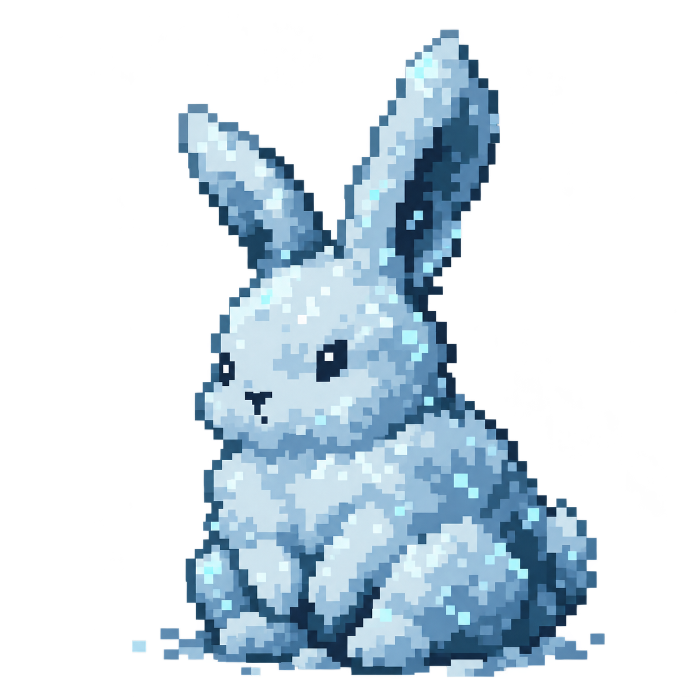
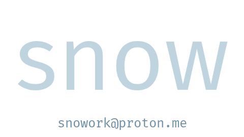
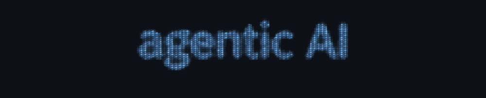
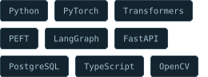
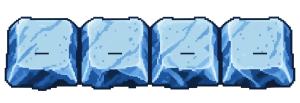

  
  

    <a href="mailto:snowork@proton.me"><picture><source media="(max-width: 600px)" srcset="assets/snow-mobile.png" /></picture></a> 
    
  

<table align="center" width="100%">
  <tr>
    <td width="60%" valign="top">
      <h4 align="center">Wins</h4>
      
<samp>1st · OpenAI BuildWeek</samp>

      
<samp>1st · Automate India · Microsoft</samp>

      
<samp>1st · T-Hacks 8.0 · IEEE GGSIPU</samp>

      
<samp>2nd · HackVision · IEEE NSUT</samp>

    </td>
    <td width="40%" valign="top">
      <h4 align="center">Tools</h4>
      

        <picture>
          <source media="(max-width: 600px)" srcset="assets/tools-mobile.svg" />
          
        </picture>
      

      

    </td>
  </tr>
</table>

  <samp><a href="https://www.kaggle.com/snowml">kaggle</a> · <a href="https://huggingface.co/snowsadh">hugging face</a> · <a href="mailto:snowork@proton.me">snowork@proton.me</a></samp>

<h4>Activity</h4>

  <a href="https://github.com/snowsadh?tab=overview">
    <picture>
      <source media="(max-width: 600px)" srcset="assets/github-stats-mobile.svg" />
      
    </picture>
  </a>

  

  <a href="https://www.patreon.com/AnasAbdin">@anasabdin</a> · personal remix

