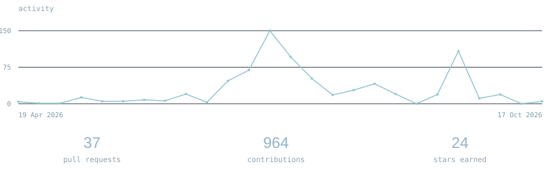
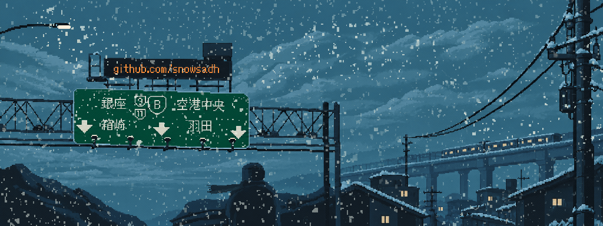

  <pre style="font-family: 'IBM Plex Mono', monospace; text-align: center; line-height: 1.8; font-size: 14px; color: #888;">

［ snow ］
────────────────────────
ai engineer

［ tech stack ］
────────────────────────
react · nodejs · python · databases  
ai · c++ · opencv

［ contact ］
────────────────────────
<a href="mailto:snowork@proton.com">snowork@proton.me</a>
  </pre>

  <a href="https://github.com/snowsadh?tab=overview">
    <picture>
      <source media="(max-width: 600px)" srcset="assets/github-stats-mobile.svg" />
      
    </picture>
  </a>

  

  <a href="https://www.patreon.com/AnasAbdin">@anasabdin</a> · personal remix

